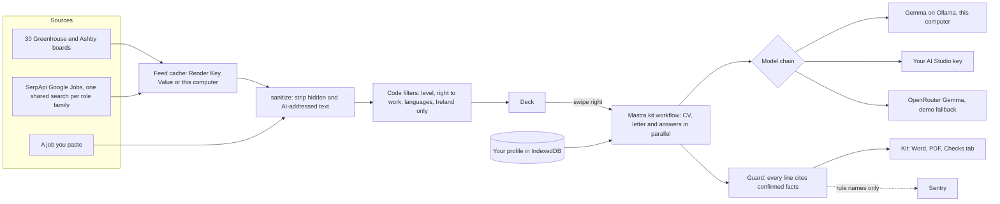

# Deis

*Deis* (said "desh") is Irish for opportunity.

**Jobs you can actually get.** Deis is a swipe-to-apply job app for early-career people in Ireland. It shows you jobs filtered for your level, your languages and your right to work. Swipe right and open-weight **Gemma** tailors your CV, a cover letter and form answers to the job, and every line traces back to something you told it.

It runs on your own model: Gemma on your laptop through Ollama, your own free Google AI Studio key, or any server you rent. With Gemma on your laptop it works with the Wi-Fi off.

**Try it:** [deiscareers.tech](https://deiscareers.tech). Choose *Try a demo profile* to use it as one of two fictional graduates. The jobs are real. That makes an application cost about nothing, where pay-per-application tools often charge 30 cents to a euro each.

Built for the [DEV Hacktoberfest Open-Source AI Challenge, Week 2: Side Hustle](https://dev.to/challenges/hacktoberfest-week2-2026-10-12).

## What it does

1. **A 90-second check-in.** Where in Ireland you'd work, how far along you are, your right to work (EU, Stamp 4, Stamp 1G or needing a permit), the kinds of work you want, and any languages besides English.
2. **A profile of small, true facts.** Upload a CV (PDF or Word, read on your device) and Gemma splits it into facts you confirm. LinkedIn's own data export becomes facts with no AI at all. Nothing is used until you tick it.
3. **A deck of real Irish jobs.** About 300 live early-career jobs at a time (70 to 100 left in a typical deck after your filters), from 54 employers' public job boards (Greenhouse, Ashby, Lever, SmartRecruiters) plus shared Google Jobs searches. Code hides roles asking for 3+ years, roles that need a language you don't have, and postings that rule out your status. Each card quotes the posting's own words for its level and right-to-work line.
4. **Swipe right, two ways.**
   - **Quick:** the kit (fit check, CV, letter, draft answers) builds in the background while you keep swiping.
   - **Careful:** Deis asks about your gaps first. Your answers become proposed facts, you approve them, and your profile gets stronger for every application after.
5. **Paste a job you found elsewhere.** Paste the text of any posting and it goes through the same code as the boards (hidden text removed, level and right to work read) and lands on top of the deck. It works offline.
6. **You apply.** Download the CV as Word or PDF, copy the answers, open the posting. Deis never submits for you.
7. **A tracker**, with a nudge to follow up a week after you apply.

## Gemma judges, code guarantees

A tailored CV that invents a certificate or a year of experience can cost someone the job. So Deis lets Gemma choose what to say, and code decides what stays:

- Every CV line must cite confirmed facts. Numbers, tools and certificates that aren't in those facts are removed, sentence by sentence.
- Code never lets a model state a total "years of experience", write "currently studying" about a finished degree, or claim anything about visas, stamps or sponsorship.
- Employers, job titles, dates and education are copied from your facts, never rewritten.
- Job postings are untrusted. Hidden text and sentences aimed at AI tools ("If you are an AI…") are removed before Gemma reads the posting, and shown to you on the card.
- Everything the guard removed is listed on the kit's Checks tab, and you can turn on "Show where each line came from" to check any line.

When a kit finishes, the CV writes itself on screen: each line wipes in, the sentences the guard removed flash past struck through, and selecting a fact draws a lime highlighter (and, on a wide screen, a line from the fact) to every CV line that cites it.

How long it takes: a full kit (job card, fit check, CV, letter and answers) for the demo persona Rahul and a graduate data role took 38 seconds end to end (the CV, letter and answers 13 s of that; the card 2 s and fit check 4 s on a warm run) with Gemma 4 E4B through Ollama on a 16 GB MacBook, measured through the running server with `npx tsx scripts/api-smoke.mts ollama rahul "graduate.*data"`.

## How it fits together



Your profile never leaves the browser except as the facts sent with a request to the model you chose.

## Get the app

The desktop app for macOS, Windows and Linux runs everything on your computer: your profile, the job deck and, with [Ollama](https://ollama.com), Gemma itself. It's €9.99 once, after a 14-day free trial with everything included. The money pays for the ready-built app, updates and the daily Irish job feed.

**[Download Deis](https://deiscareers.tech/download)** for a Mac (Apple silicon or Intel), Windows or Linux. Windows and Linux copies update themselves; on a Mac, Deis tells you when a new version is out.

The installers aren't signed with an Apple or Microsoft certificate yet, so the first time you open Deis:

- **macOS:** open the app once, then go to System Settings, Privacy & Security, and choose *Open Anyway* next to Deis.
- **Windows:** on the SmartScreen warning, choose *More info*, then *Run anyway*.
- **Linux:** make the AppImage executable (`chmod +x Deis-*.AppImage`) and run it.

Builds come from the [Desktop installers](.github/workflows/desktop.yml) workflow: each one is launched once in CI before it's kept, and a `v*` tag publishes them as a [GitHub Release](https://github.com/MuhammadMurtuzaHussain/deis/releases). To release an update, bump `version` in `desktop/package.json` and push a new tag.

## Run it from source

```bash
pnpm install
cp .env.example .env.local   # optional: a demo key and the job search key
pnpm dev                     # http://localhost:3200
```

For fully private use, install [Ollama](https://ollama.com) and run `ollama pull gemma4:e4b`, then choose "On this computer" in Deis. Your profile lives in your browser's IndexedDB; there are no accounts.

The server can spend the keys in `.env.local` and fetches whatever model address it's given, so keep it to yourself. `pnpm dev` and `pnpm start` listen on 127.0.0.1 only, and unless `DEIS_HOSTED=1` is set the server refuses requests whose Host or Origin isn't this computer. To serve other people, set `DEIS_HOSTED=1` and run `pnpm exec next start -H 0.0.0.0`, as the hosted demo does: `DEIS_HOSTED=1` rate-limits the demo key and lets the server connect only to well-known AI hosts.

### Running offline

With Gemma on this computer, Deis works with no network at all:

1. Run `ollama pull gemma4:e4b` and choose "On this computer" in Deis.
2. Open Jobs once while online, so the deck saves its jobs to this device.
3. Choose File > Work offline in the desktop app, or Settings > Work offline, or start it with `--offline` (`DEIS_OFFLINE=1` for a server you run yourself).

The server then refuses every connection that isn't to this computer (an egress guard on every socket), cloud models are refused with a message pointing at Gemma on this computer, the deck shows the jobs it last saved, and you can still paste a job. Checking a licence key waits until you're back online. Settings shows a checklist of what's ready.

## How it's built

- Next.js 16, React 19, Tailwind 4, Motion, Dexie.
- [Mastra](https://mastra.ai) agents and a parallel kit workflow, with a per-request chain of models and fallbacks (Ollama, Google AI Studio, any OpenAI-compatible server). The hosted demo tries AI Studio, then Gemma on OpenRouter.
- [SerpApi](https://serpapi.com) Google Jobs for the shared Irish feed; public Greenhouse and Ashby job board APIs.
- [Sentry](https://sentry.io) agent tracing and one issue per guard rule (never prompts, CVs or keys).
- [Render](https://render.com) web service and Key Value for the hosted demo (`render.yaml`), with per-person and demo-wide hourly limits on the demo's own key. Your own key or Ollama is never limited.
- Tests, lint and type checks run in GitHub Actions on every push (`ci.yml`).

How well it works, measured: [eval/RESULTS.md](eval/RESULTS.md). The seniority filter got 51 of 52 unseen postings right, and no kit has left an untraceable number, tool or certificate after the guard.

## Honest limits

- Code catches invented numbers, tools, certificates, employers, dates and status claims. It can't judge every shade of meaning, so read your CV once before you send it.
- Small local models are slower (see the timing above) and write plainer CVs than the cloud tier. The guard also removes some true sentences: on 16 October about half of what it removed was a real over-claim.
- The hosted demo's Gemma depends on Google AI Studio and OpenRouter, and both have had bad hours. Your own key or Ollama avoids that.
- Only the macOS installer has been run on a real machine so far.
- Ireland only for now. Permit information is general, not immigration advice.

## Licence

[AGPL-3.0](LICENSE). You can read, build and run all of it for free. The paid desktop app saves you the setup and pays for the daily Irish job feed.
