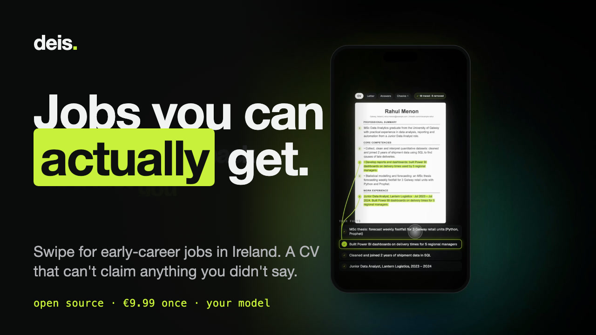
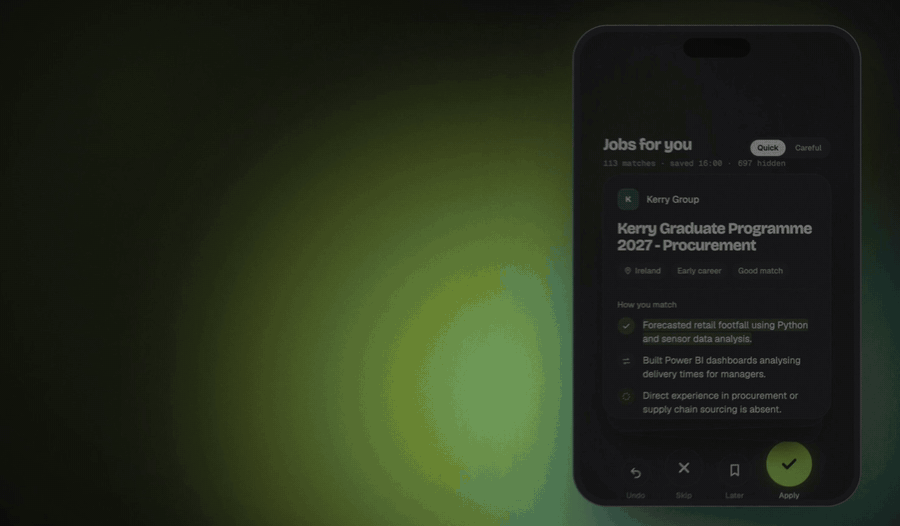
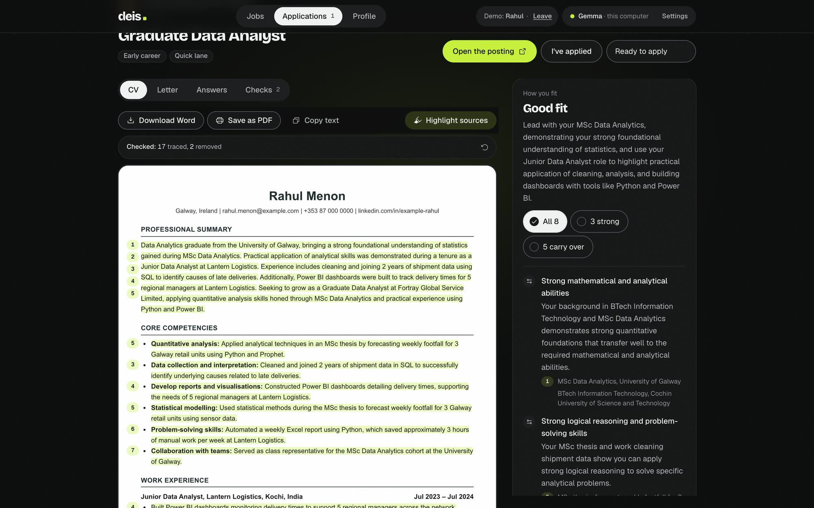
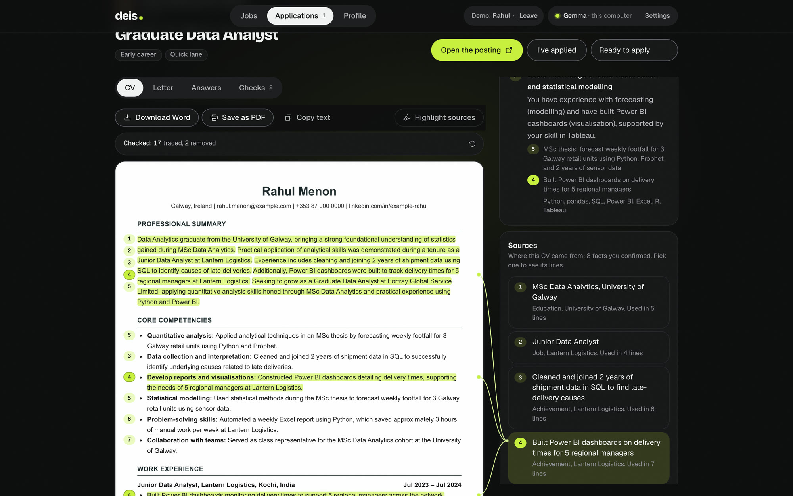
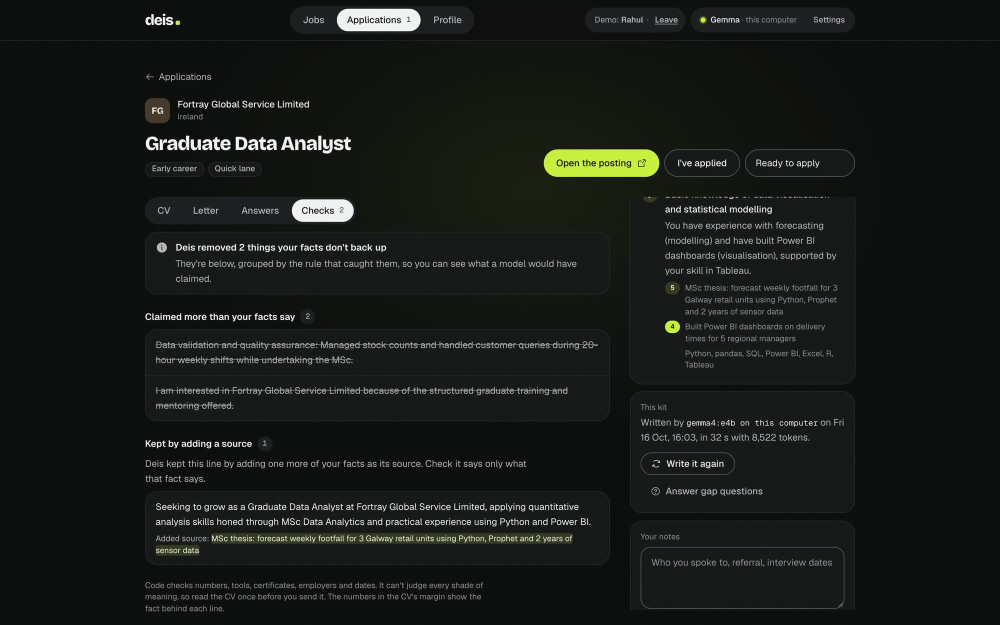
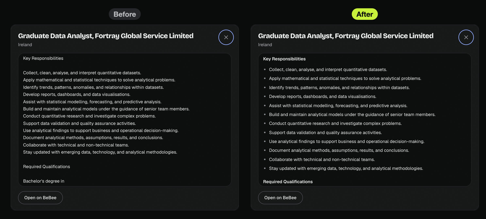
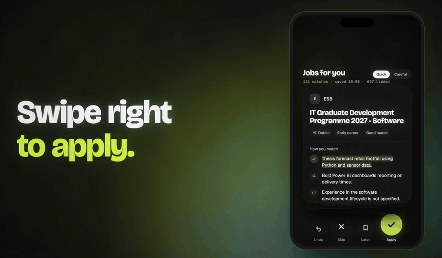
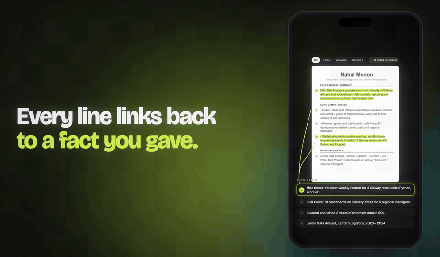
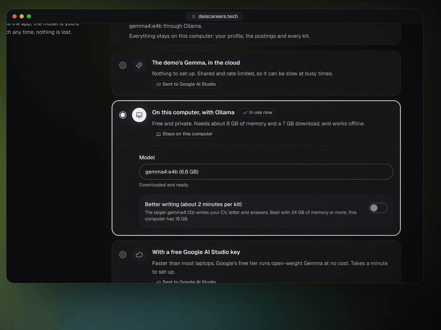
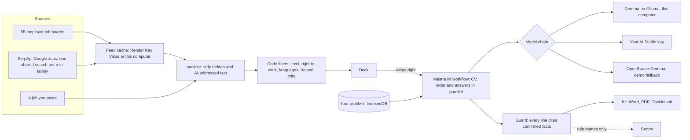

<p align="center">
  <a href="https://youtu.be/LXKSvYJGxeA"></a>
</p>

<p align="center">
  <b>Jobs you can actually get.</b> A swipe-to-apply job app for early-career people in Ireland, where open-weight <b>Gemma 4</b> tailors your CV and code removes anything it can't back up.
</p>

<p align="center">
  <a href="https://deiscareers.tech"><b>Try the web demo</b></a> ·
  <a href="https://youtu.be/LXKSvYJGxeA">Watch the film (1 min)</a> ·
  <a href="https://dev.to/muhammadmurtuzahussain">DEV post</a> ·
  <a href="#download">Download</a> ·
  <a href="mailto:hello@deiscareers.tech">hello@deiscareers.tech</a> ·
  Built for the <a href="https://dev.to/challenges/hacktoberfest-week2-2026-10-12">DEV Hacktoberfest Open-Source AI Challenge, Week 2: Side Hustle</a>
</p>

<p align="center">
  <a href="https://github.com/MuhammadMurtuzaHussain/deis/releases/latest/download/Deis-mac-arm64.dmg"></a>
  <a href="https://github.com/MuhammadMurtuzaHussain/deis/releases/latest/download/Deis-mac-x64.dmg"></a>
  <a href="https://github.com/MuhammadMurtuzaHussain/deis/releases/latest/download/Deis-windows-x64.exe"></a>
  <a href="https://github.com/MuhammadMurtuzaHussain/deis/releases/latest/download/Deis-linux-x86_64.AppImage"></a>
  <a href="https://github.com/MuhammadMurtuzaHussain/deis/releases/latest/download/Deis-android.apk"></a>
  <br />
  <a href="https://deiscareers.tech/checkout?products=fb94fe7f-d0f8-49a0-8854-4bbe41f25496"></a>
</p>

<p align="center">
  
</p>

*Deis* (said "desh") is Irish for opportunity.

## Why

I tailored 83 CVs by hand this autumn: one per job, each rewritten to the job ad's own words and checked so it didn't claim anything I couldn't defend in an interview. Most early-career people I know do the same thing, alone, at night. The AI tools that do it for you charge per application and write things you'd never sign: "3 years of experience", "no sponsorship needed".

Deis keeps your facts in one place, hides the Irish jobs you can't get before you see them, lets Gemma write the kit, and lets code decide what stays. It runs on your own model, so an application costs about €0.

## What it does

| | |
|---|---|
| **A 90-second check-in** | Where in Ireland you'd work, how far along you are (studying to 7+ years), your right to work (EU, Stamp 4, Stamp 1G or a permit), the kinds of work you want (tech, tax, accounting, management and more, with search) and your languages. |
| **A profile of true facts** | Upload a CV (read on your device) and Gemma splits it into facts you confirm. LinkedIn's data export becomes facts with no AI at all. Nothing is used until you tick it. |
| **A deck of real Irish jobs** | About 300 live jobs at a time from 55 employers' public job boards (Greenhouse, Ashby, Lever, SmartRecruiters) and shared Google Jobs searches. Code hides roles above your level, in languages you don't have, or closed to your status, and quotes the posting's own words on each card. |
| **Swipe right, two ways** | *Quick* builds the kit (fit check, CV, letter, answers) in the background while you keep swiping. *Careful* asks about your gaps first and turns your answers into facts you approve. |
| **Paste any job** | A posting you found elsewhere goes through the same code and lands on top of the deck. It works offline. |
| **Every line traced** | Select a fact and a lime highlighter draws behind every CV line that cites it. The Checks tab lists everything the guard removed. |
| **You apply** | Word or PDF, copy the answers, open the posting. Deis never submits for you. A tracker nudges you to follow up. |
| **Your model** | Gemma on your laptop through Ollama (Wi-Fi off, if you like), your own free AI Studio key, or any server you rent. |

## Screenshots

| The kit, with the fit check | Select a fact, see every line it backs |
|---|---|
|  |  |
| **What the guard removed** | **The full posting, with its lists back** |
|  |  |

## Gemma judges, code guarantees

A tailored CV that invents a certificate or a year of experience can cost someone the job. Gemma chooses what to say; code decides what stays.

- Every CV line must cite confirmed facts. Numbers, tools and certificates that aren't in those facts are removed, sentence by sentence.
- No model may state a total "years of experience", write "currently studying" about a finished degree, or claim anything about visas, stamps or sponsorship.
- Employers, job titles, dates and education are copied from your facts, never rewritten.
- Postings are untrusted: hidden text and sentences aimed at AI tools are removed before Gemma reads them, and shown to you on the card.

<p align="center">
  
  
</p>

A full kit for the demo graduate Rahul took 38 seconds end to end with Gemma 4 E4B through Ollama on a 16 GB MacBook (`npx tsx scripts/api-smoke.mts ollama rahul "graduate.*data"`).

## Download

The desktop app runs everything on your computer: your profile, the deck and, with [Ollama](https://ollama.com), Gemma itself. **14 days free, then €9.99 once.** October only: the code `hacktoberfest2026` is applied for you at checkout, so it's €2.

| Build | File | Notes |
|---|---|---|
| macOS, Apple silicon | [Deis-mac-arm64.dmg](https://github.com/MuhammadMurtuzaHussain/deis/releases/latest/download/Deis-mac-arm64.dmg) | macOS 12 or later. Tells you when a new version is out. |
| macOS, Intel | [Deis-mac-x64.dmg](https://github.com/MuhammadMurtuzaHussain/deis/releases/latest/download/Deis-mac-x64.dmg) | macOS 12 or later. |
| Windows | [Deis-windows-x64.exe](https://github.com/MuhammadMurtuzaHussain/deis/releases/latest/download/Deis-windows-x64.exe) | Windows 10 or 11, 64-bit. Updates itself. |
| Linux | [Deis-linux-x86_64.AppImage](https://github.com/MuhammadMurtuzaHussain/deis/releases/latest/download/Deis-linux-x86_64.AppImage) | 64-bit. Updates itself. |
| Android | [Deis-android.apk](https://github.com/MuhammadMurtuzaHussain/deis/releases/latest/download/Deis-android.apk) | Free. Runs the web demo (two sample graduates). |
| iPhone | [deiscareers.tech](https://deiscareers.tech) | Free. Safari, Share, *Add to Home Screen*. Runs the web demo. |

The installers aren't signed with an Apple or Microsoft certificate yet, so the first time you open Deis:

- **macOS:** open it once, then System Settings, Privacy & Security, *Open Anyway*.
- **Windows:** on the SmartScreen warning, *More info*, then *Run anyway*.
- **Linux:** `chmod +x Deis-*.AppImage`, then run it.

Questions before you buy, or a key that won't work? Email [hello@deiscareers.tech](mailto:hello@deiscareers.tech).

Your own CV is read only by the desktop app. The web demo and the phone apps run two fictional graduates on real Irish jobs, so a real CV never reaches the server. Builds come from the [Desktop installers](.github/workflows/desktop.yml) and [Android app](.github/workflows/android.yml) workflows; each one is launched in CI before it's released.

## Run it locally

Requires [Node 24](https://nodejs.org), [pnpm](https://pnpm.io) and, for private use, [Ollama](https://ollama.com).

```bash
ollama pull gemma4:e4b       # ~6.6 GB; then choose "On this computer" in Deis
git clone https://github.com/MuhammadMurtuzaHussain/deis && cd deis
pnpm install
cp .env.example .env.local   # optional: a demo key and the job search key
pnpm dev                     # http://localhost:3200
```

Your profile lives in your browser's IndexedDB; there are no accounts. The server can spend the keys in `.env.local`, so keep it to yourself: it listens on 127.0.0.1 and refuses requests whose Host or Origin isn't this computer. To serve other people, set `DEIS_HOSTED=1` and run `pnpm exec next start -H 0.0.0.0`, as the hosted demo does; that rate-limits the demo key, takes no real CVs and lets the server reach only well-known AI hosts.

### Running offline



1. `ollama pull gemma4:e4b` and choose "On this computer".
2. Open Jobs once while online, so the deck saves its jobs.
3. File > Work offline in the desktop app, Settings > Work offline, or start with `--offline` (`DEIS_OFFLINE=1` for a server you run).

The server then refuses every connection that isn't to this computer (an egress guard on every socket), the deck shows the jobs it saved, and you can still paste a job and build a kit. Settings shows a checklist of what's ready.

<br clear="right" />

## How it's built

| Piece | Role |
|---|---|
| **Gemma 4** (open weights) | Every AI job: job cards, fit check, CV, letter, answers, gap questions. E4B or 12B on your laptop through Ollama; 26B on AI Studio or OpenRouter for the demo. |
| **Mastra** | One agent per task, a per-request chain of models with fallbacks, and a kit workflow that writes the CV, letter and answers in parallel. Scorers with no model judge check every hosted kit (`src/mastra/scorers.ts`). |
| **Code guard** | [`src/lib/cv/guard.ts`](src/lib/cv/guard.ts): every sentence checked against the facts it cites. Seniority, right to work, languages and Ireland-only filters in [`src/lib/jobs/`](src/lib/jobs). |
| **SerpApi** | Google Jobs as one shared, cached search per role family for all of Ireland, plus public job board APIs. |
| **Sentry** | Agent tracing (a span per workflow step and Gemma call) and one issue per guard rule. Never a CV, a prompt or a key. |
| **Render** | The web service and Key Value for the demo, the shared job feed and the demo key's limits ([`render.yaml`](render.yaml)). |
| **Next.js 16, Electron, Capacitor** | One app: the web demo, the desktop app around the same server on `127.0.0.1`, and the Android shell. Dexie for local data, Motion for the highlighter. |



## Evaluation

The details and scripts are in [eval/RESULTS.md](eval/RESULTS.md).

| What | Result |
|---|---|
| Seniority filter, 52 hand-labelled postings it had never seen | 51 right on the first run; the miss is now fixed |
| Guard, eight kits by Gemma 4 E4B on a laptop (16 Oct) | 196 sentences kept, 11 removed (5.3%), 0 untraceable claims left |
| Of the removals, read by hand | About half real over-claims; the rest true lines it was too strict about |
| Tests | `pnpm test` (360+), lint and types on every push in GitHub Actions |

## First users

The first person who used Deis properly wasn't who I built it for: an MBA student with ten years in tax, looking for accountancy roles. Their call shaped the app (career stages up to 7+ years, kinds of work beyond tech, postings that keep their lists), and they bought it on the call. The second sale came from someone I'd never met, by word of mouth. The story is in the DEV post.

## Privacy

- **Desktop app:** your profile, applications and, with Ollama, the model stay on your computer.
- **Web demo and phones:** two fictional graduates only; a real CV is refused by the server.
- **Your own AI Studio key or server:** the facts for each request go to the model you chose, and nowhere else.
- **Tracing:** Sentry and Mastra get step names, timings, token counts and guard rule names. Never a CV, a prompt or a key.

## Honest limits

- Code catches invented numbers, tools, certificates, employers, dates and status claims. It can't judge every shade of meaning, so read your CV once before you send it.
- Small local models are slower and write plainer CVs than the cloud tier.
- The hosted demo's Gemma depends on Google AI Studio and OpenRouter, and both have had bad hours. Your own key or Ollama avoids that.
- Only the macOS installer has been run on a real machine so far; the Android app has run on an emulator in CI.
- Ireland only, on purpose: CV styles, languages and what employers expect differ by country. Permit information is general, not immigration advice.

## Licence and credits

[AGPL-3.0](LICENSE): read, build and run all of it for free. The paid desktop app saves you the setup and pays for the daily Irish job feed.

Made by [Muhammad Murtuza Hussain](https://github.com/MuhammadMurtuzaHussain) in Galway, for the DEV Hacktoberfest Open-Source AI Challenge, October 2026. Built with AI assistance (Claude Code).
